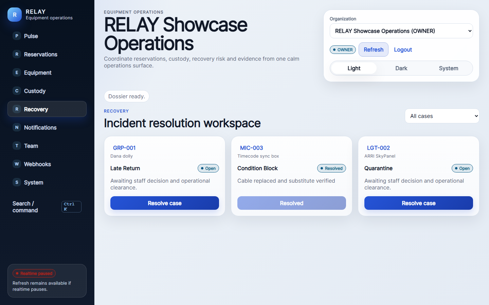
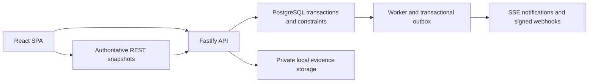
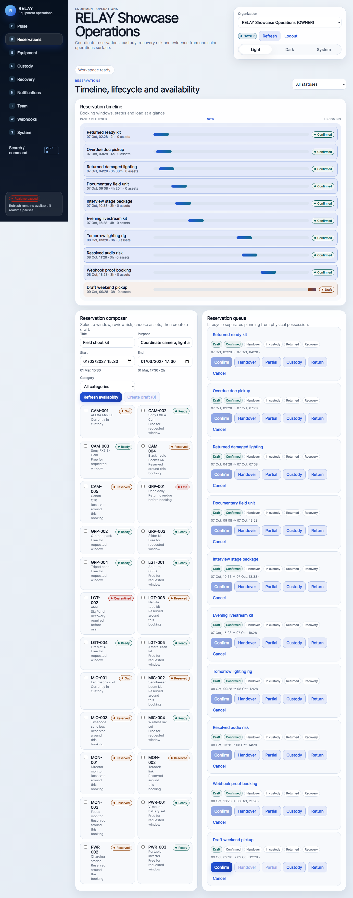
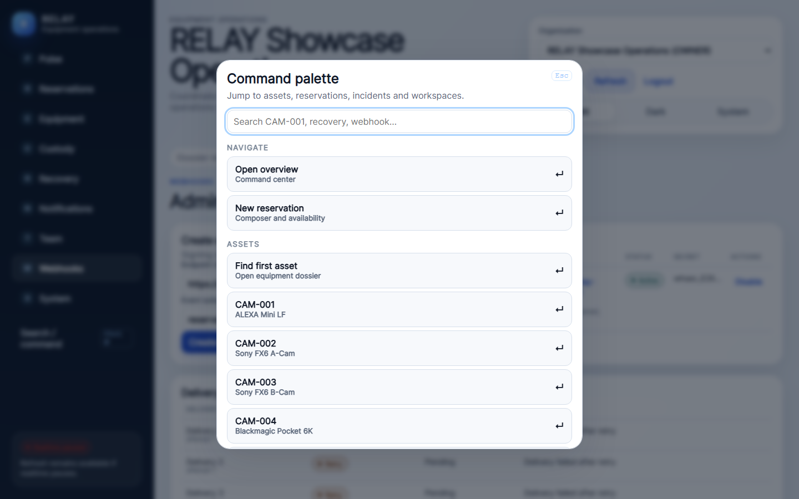

# RELAY — Equipment Operations

**A full-stack product that keeps equipment reservations, physical custody and recovery risk consistent across operators.**

I built RELAY around a practical distinction: a booking says equipment is promised; custody says who physically has it. Late returns and damaged assets need explicit recovery workflows rather than quietly rewriting the next booking. The result combines a React interface, Fastify API, PostgreSQL transactions, a worker and private evidence storage.

Saved release validation covers local Docker Compose deployment, backup/restore and restart recovery. Present-snapshot tests, typecheck and build are reported separately in [validation](VALIDATION.md). This is local single-host engineering evidence, not customer adoption or internet-scale operation.

## Problem and technical difficulty

Competing confirmations can allocate the same asset; physical return may lag a scheduled reservation; condition evidence must stay private; background effects can retry; authorization must remain tenant-aware. Interface state must help an operator understand these distinctions without treating realtime hints as authoritative records.

## What I built

A React/TypeScript/Vite SPA, Fastify API, same-codebase worker, PostgreSQL persistence and migrations, tenant-aware sessions/permissions, reservations, partial custody/return, recovery, condition evidence, durable jobs/outbox, SSE and signed webhooks. I also built deployment/recovery tooling and a keyboard-oriented operational interface.

## System architecture

No Redis, message-broker fleet, Kubernetes or cloud object-store deployment is implied. [Architecture and decisions](ARCHITECTURE.md).

## Engineering depth and key decisions

- Separate planned allocation from physical possession and condition readiness.
- Enforce reservation conflicts with transactions and database constraints.
- Commit business changes with durable jobs/outbox work; make retries observable.
- Keep evidence files behind authorized retrieval rather than public file paths.
- Use SSE as timely feedback while REST snapshots remain authoritative.
- Test local deployment, backup/restore, restart and security/accessibility behavior.

## Verified results and validation evidence

Historical release evidence records nine passing gate groups: containers, deployment, final workflow, security/configuration, accessibility, local load smoke, backup/restore, restart recovery and clean install/build. The final load smoke was **12 successful requests in approximately 38.153 ms aggregate**; it is not a throughput or capacity claim.

Present reconciliation proved the sole package-file delta against its saved hash is the added `demo:reset` script. The historical lockfile hash still matches. The added script exposes an existing development/test showcase reset; it does not change production startup or dependency requirements. [Snapshot explanation and fresh checks](VALIDATION.md), [evidence guide](EVIDENCE.md), [bounded results](evidence/results.json).

## Representative screenshots

Captures are authored showcase scenarios, not real customer activity. Timeline labels show zero assets in this historical capture, and realtime can show paused; the images are interface evidence, not transaction-correctness proof. No host-identifier topology or populated login screenshot is included. [Screenshot register](SCREENSHOT_REGISTER.md).

## Setup / reproduction boundary

This export is a case study, not the application source package. Full local reproduction requires owner-cleared source, Node/pnpm, PostgreSQL, migrations and private local evidence storage. The present check used only a fresh isolated test database; it did not touch the existing development database. No deployment secrets, database dump or environment file is included. [Reproduction scope](REPRODUCIBILITY.md).

## Hardware / resource context

The implementation targets a conservative local envelope: one API, one database, one worker loop, a bounded connection pool and local files. Current checks used Node 22.14.0 and installed pnpm 11.25.0; project metadata requests pnpm 11.19.0. Historical UI budget evidence reported approximately 109 KB gzipped JS and 5.4 KB gzipped CSS; this is bundle evidence, not server capacity.

## Limitations

Local single-host verification only. No internet-scale benchmark, customer adoption, paid cloud or public TLS deployment is claimed. External webhook effects can repeat and arrive out of order; there is no exactly-once claim. Deployed service roles use **BYPASSRLS**: application authorization remains essential, and direct RLS tests do not establish RLS enforcement for those roles. Storage is local; S3, malware scanning and managed-cloud recovery are outside this release. Present tests do not rerun the historic Docker backup/restore gate.

## Provenance / redistribution and intentional exclusions

Owner source-license and third-party dependency review remain pending. The export deliberately excludes all application source for now, local environments, passwords/session/webhook secrets, browser profiles, PostgreSQL data, logs, SQL dumps, evidence TAR backups, private photos and operational fixture state. Only individually reviewed interface captures and aggregate descriptions are selected.

## Project status and publication scope

The engineering project is complete within the bounded scope described here. This staged repository is a **case study and evidence summary**, not a runnable source distribution. No source license is selected or granted by these documents. Publication is awaiting owner review. See [source-release decision](SOURCE_RELEASE_DECISION.md), [provenance](PROVENANCE.md), [validation](VALIDATION.md) and [file manifest](PUBLIC_EXPORT_MANIFEST.json).
